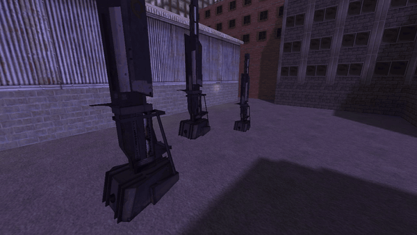

<h1 align="center">Combine Thumper</h1>

<p align="center">
  
</p>

## 📝 Description
This plugin adds placeable Combine Thumpers to Counter-Strike 1.6, inspired by Half-Life 2.
Players can configure Thumpers with different effects, including screen shaking, damage and powerful knockback.
- Place and configure Combine Thumpers around the map
- Customize thumping speed, damage and push force
- Configure affected teams and usage restrictions by team
- Adjust screen-shaking and impact ranges
- Scale damage and push force with configurable factors
- Preview placements with adjustable distance and rotation
- Save and load Combine Thumper placements per map
- Choose between normal and small Combine Thumper models
- Configure default behavior and create custom Thumper presets

## 📋 Requirements
- ReGameDLL
- AMX Mod X 1.10+

## ⚙️ Configuration
```ini
# To add a new Combine Thumper, follow the example below:
# [Combine Thumper Name]
# THUMPER_FLAGS           = a - Shaker, b - Damage, c - Push
# THUMPER_TEAM            = 0 - None, 1 - Terrorist, 2 - Counter-Terrorist, 3 - Both
# THUMPER_USE_TEAM        = 0 - None, 1 - Terrorist, 2 - Counter-Terrorist, 3 - Both
# THUMPER_FRAMERATE       = Default framerate (1.0 = normal speed)
# THUMPER_DAMAGE          = Minimum and maximum damage (MIN MAX)
# THUMPER_DAMAGETYPE      = Damage type
# THUMPER_PUSH_FORWARD    = Minimum and maximum forward push force (MIN MAX)
# THUMPER_PUSH_UP         = Minimum and maximum upward push force (MIN MAX)
# THUMPER_RANGE_SHAKE     = Minimum and maximum screen-shake range (MIN MAX)
# THUMPER_RANGE_IMPACT    = Minimum and maximum impact range (MIN MAX)
#
# Define a section name to make a Combine Thumper available in the menu.
# Models and sounds cannot be changed dynamically during gameplay.
```

## 🔄 Changelog
```text
* v1.0: Initial release.
```

[](https://www.youtube.com/watch?v=DpkAH8w0KUs)
